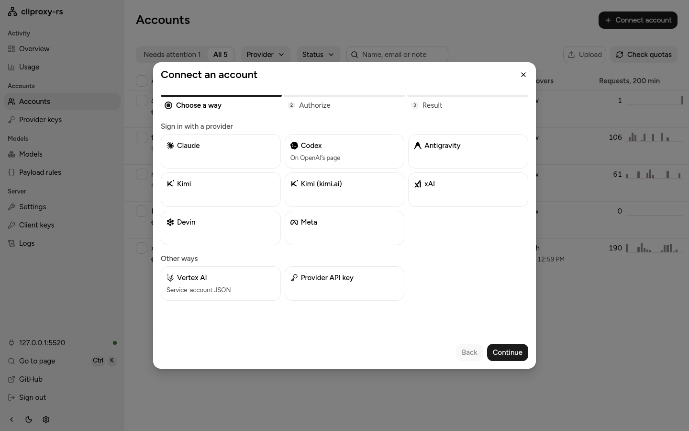
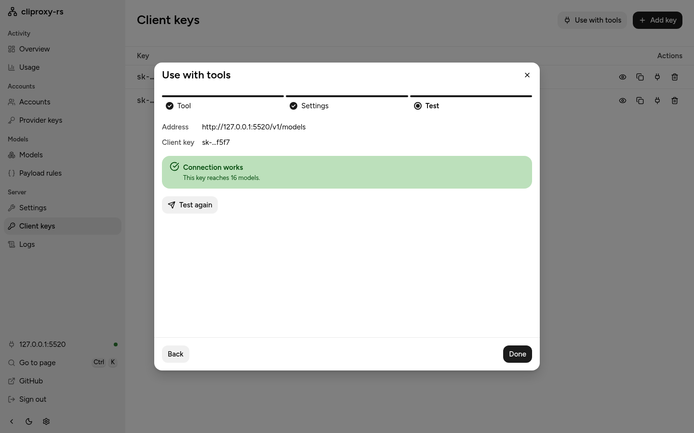

# Getting started

This guide connects a coding tool to your own accounts or API keys through cook-router. For Codex CLI with API keys and mixed providers, start with the [README recipe](../README.md#api-keys-codex-cli-and-mixed-providers).

## 1. Start it

Run the Docker image with a data directory that holds an initial `config.yaml`:

```sh
mkdir -m 700 -p data
$EDITOR data/config.yaml                  # see INSTALL.md for a minimal file
sudo chown -R 10001:10001 data
docker run -d --name cook-router -p 127.0.0.1:8317:8317 -v "$PWD/data:/data" ghcr.io/prep-cook/cook-router:latest --db /data/cook.db --config /data/config.yaml
```

[INSTALL.md](INSTALL.md#docker) covers the volume, the config file and upgrades. The first start imports `config.yaml` into `/data/cook.db`; later starts use the database. Two keys matter:

- `management.secret-key` in the imported config (or the `COOK_MANAGEMENT_PASSWORD` environment variable) is the dashboard password.
- An entry under `access.api-keys` is what your tools send to the proxy.

Check that the server answers with `curl http://127.0.0.1:8317/healthz`.

## 2. Open the dashboard

Open <http://127.0.0.1:8317/management.html> in your browser and sign in with the management key. On a server without a browser, open an SSH tunnel from your own computer first, as [INSTALL.md](INSTALL.md#docker) shows.

On a new server, the Overview shows a short Get started card with three steps: connect an account, point a tool at the proxy, and send a test request. It goes away once all three are done, or when you dismiss it.

## 3. Connect an account

<picture>
  <source media="(prefers-color-scheme: dark)" srcset="img/connect-dark.png">
  
</picture>

In the dashboard, choose Connect account and pick a provider. Claude and ChatGPT (Codex) open the provider's own sign-in page; Kimi, Meta, xAI and Devin show a device code to enter on their site. The proxy stores sign-in and refresh tokens in SQLite, not in files. It never sees your password.

You can also sign in from a terminal, which helps on a server without a browser. The running proxy owns its database, so the terminal sign-in goes through it:

```sh
docker exec -it cook-router cook-router --management-base-url http://127.0.0.1:8317 --claude-login --no-browser
```

When asked, type the management key; it is not shown as you type.

The other sign-in flags are `--codex-login`, `--codex-device-login`, `--kimi-login`, `--meta-login`, `--xai-login` and `--devin-login`. API keys for Claude, Codex, Gemini, Vertex AI, xAI and OpenAI-compatible services go on the dashboard's Provider keys page.

Read [Accounts and provider terms](../README.md#accounts-and-provider-terms) before using a subscription. This setup is for one person using their own accounts on their own machines. Use provider-sanctioned integrations or API keys where available.

## 4. Point a tool at it

<picture>
  <source media="(prefers-color-scheme: dark)" srcset="img/use-dark.png">
  
</picture>

The dashboard's Use with tools dialog, on the Client keys page, shows this server's address and your client key with copy buttons, and tests the key. For Claude Code, for example:

```sh
export ANTHROPIC_BASE_URL=http://127.0.0.1:8317
export ANTHROPIC_AUTH_TOKEN=PASTE-YOUR-CLIENT-KEY
claude
```

[CLIENTS.md](CLIENTS.md) has the setup for Codex CLI, Gemini CLI, Amp, OpenCode, Cursor, Cline, Zed, Aider, the SDKs and more.

## Running it safely

- Always set `access.api-keys`. With an empty list, anyone who can reach the proxy can use your accounts. The server logs a warning at start when the list is empty.
- Keep `server.host` on `127.0.0.1` unless other machines need it. An empty host listens on every network interface. To use the proxy from your other machines, a private network such as Tailscale is the simplest safe option; see [MULTI-ACCOUNT.md](MULTI-ACCOUNT.md#reach-the-proxy-from-other-machines).
- The management API is off until `management.secret-key` (or the `COOK_MANAGEMENT_PASSWORD` environment variable) is set. With `management.allow-remote: false`, the default, only requests from this computer are accepted. Five wrong keys from one address block that address for 30 minutes.
- Behind a tunnel or reverse proxy on the same machine (cloudflared, `tailscale serve`, Caddy, nginx), every request arrives from `127.0.0.1`, so the server treats every internet client as local. Then `allow-remote: false` no longer keeps them out, a local-only `--password` is accepted from the internet, and five wrong keys from anyone block the tunnel for everyone. Set `server.trusted-proxies` to the proxy's address, for example `[127.0.0.1, "::1"]` for a local cloudflared, and restart. The server then takes the client address from `X-Forwarded-For` from that proxy only. CLIProxyAPI behaves the same way.
- The dashboard sends the management key once and then holds a session cookie the page's scripts cannot read. The session lasts 7 days, or 30 with "Remember on this device". Signing out, changing `management.secret-key` or restarting the server ends it. Behind a reverse proxy, list it in `server.trusted-proxies`: the server then reads its `X-Forwarded-Proto`, to mark the cookie `Secure` over HTTPS, and its `X-Forwarded-Host`, which dashboard changes must match when the proxy rewrites `Host`.
- Do not send keys over plain HTTP across a network. Use a tunnel or reverse proxy with HTTPS, or serve HTTPS directly with `server.tls`.
- The dashboard is built into the binary, and cook-router never downloads code to run. (CLIProxyAPI downloads its dashboard from GitHub every three hours by default.) cook-router does fetch model lists from the CLIProxyAPI project's mirrors at start and every three hours, as CLIProxyAPI does; they are JSON data, checked before use, and `--local-model` turns the fetch off.
- SQLite holds configuration secrets, client keys and OAuth tokens. Keep its directory, published snapshot, temporary working databases and backups private. Copy the `--db` snapshot directly while the service runs for a complete backup, or use `config backup`. Config revisions do not contain credential state and never restore a revoked token. Logical deletion does not guarantee physical disk erasure. See [database safety](CONFIGURATION.md#database-safety-and-backup).

## Next

- [MULTI-ACCOUNT.md](MULTI-ACCOUNT.md): several Claude or Codex accounts, routing, quotas and remote access.
- [CONFIGURATION.md](CONFIGURATION.md): the settings you are most likely to change.
- [MIGRATING-FROM-GO.md](MIGRATING-FROM-GO.md): moving over from CLIProxyAPI.
